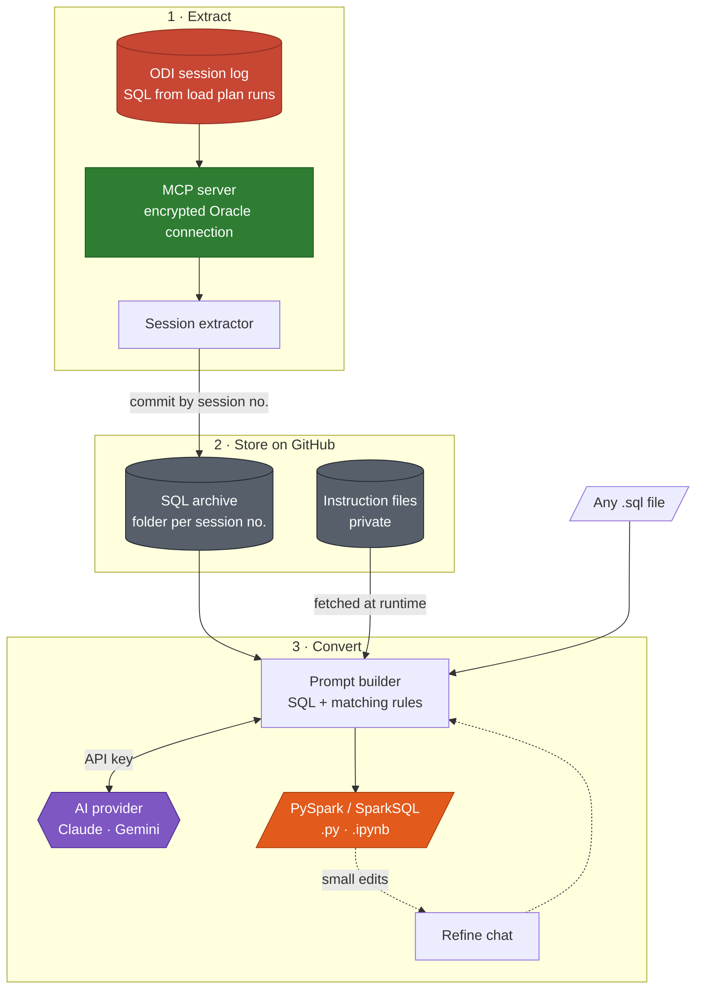
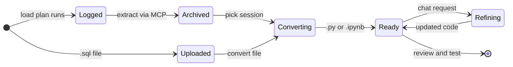
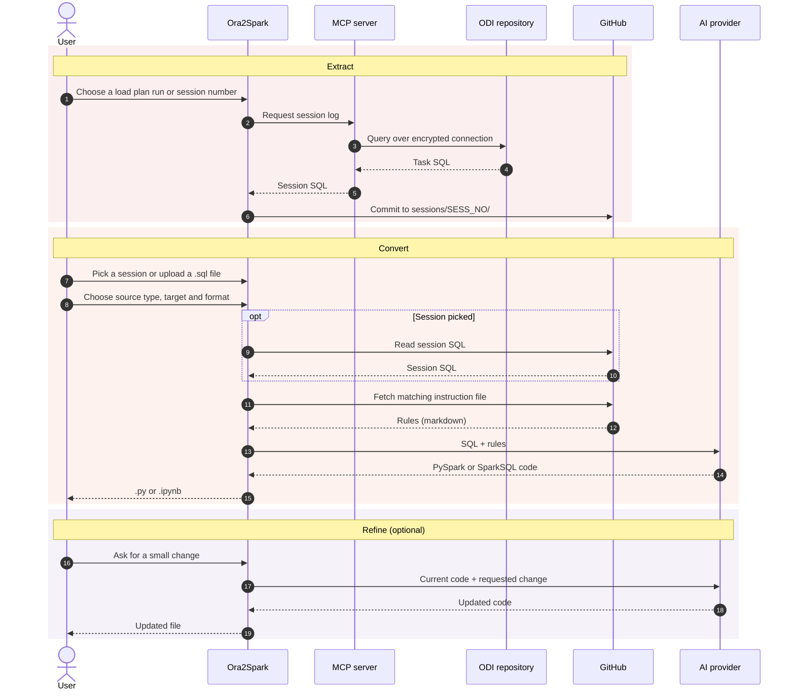

<div align="center">

# Ora2Spark

**Convert the SQL your ODI load plans actually ran into PySpark and SparkSQL, with AI.**

ODI session logs → secure MCP extraction → GitHub archive → AI conversion → `.py` / `.ipynb`

[](#quick-start)
[](#how-it-works)
[](#supported-conversions)
[](#extending)
[](#extending)
[](#output-formats)

[Overview](#overview) · [How it works](#how-it-works) · [Conversions](#supported-conversions) · [Quick start](#quick-start) · [Usage](#usage) · [Security](#security-and-privacy) · [Roadmap](#roadmap)

</div>

<!-- Demo: record a short GIF (extract, convert, refine), save it as assets/demo.gif, then uncomment:
<p align="center"></p>
-->

---

## Overview

When an ODI load plan runs, the SQL for each session task is stored in the session log. Ora2Spark uses that log as the starting point for migration: pick a session, and it converts the exact SQL that ran into PySpark or SparkSQL, applying the same versioned rules every time. SQL from anywhere else works too: upload a `.sql` file and convert it directly.

| Area | Details |
|---|---|
| **Input** | SQL from ODI load plan session logs, or any `.sql` file |
| **Database access** | MCP server over an encrypted Oracle connection |
| **SQL archive** | GitHub, one folder per ODI session number |
| **Rules** | Four markdown instruction files, fetched from GitHub at runtime |
| **AI** | Claude and Gemini through API keys; more providers can be added |
| **Output** | PySpark or SparkSQL, as `.py` or `.ipynb` |
| **Refinement** | Chat for small, targeted edits |
| **Built with** | Python, Node.js |

## Features

<table>
  <tr>
    <td width="25%" valign="top"><b>ODI session extraction</b><br/><sub>Pulls the SQL a load plan ran, straight from the session log.</sub></td>
    <td width="25%" valign="top"><b>Secure database access</b><br/><sub>Reaches Oracle through an MCP server over an encrypted connection.</sub></td>
    <td width="25%" valign="top"><b>Git-backed archive</b><br/><sub>Commits every extract to GitHub under its session number.</sub></td>
    <td width="25%" valign="top"><b>Rules as markdown</b><br/><sub>Four instruction files steer the AI. Edit a rule, no redeploy.</sub></td>
  </tr>
  <tr>
    <td width="25%" valign="top"><b>Pluggable AI</b><br/><sub>Claude and Gemini today. Add a provider with its client and API key.</sub></td>
    <td width="25%" valign="top"><b>Script or notebook</b><br/><sub>Choose <code>.py</code> or <code>.ipynb</code>. New formats plug in as writers.</sub></td>
    <td width="25%" valign="top"><b>Per-file conversion</b><br/><sub>Upload any <code>.sql</code> file and convert it on its own.</sub></td>
    <td width="25%" valign="top"><b>Refine with chat</b><br/><sub>Ask for small changes without re-running the whole conversion.</sub></td>
  </tr>
</table>

## How it works

### Architecture

Three stages: extract the SQL an ODI run executed, store it in GitHub next to the rules, then convert it with AI.



### Lifecycle

Where your SQL is at each step:



### End-to-end flow



## Supported conversions

Every source and target pair has its own instruction file. Ora2Spark picks the matching file at runtime.

| Source ↓ · Target → | PySpark | SparkSQL |
|---|---|---|
| **Oracle SQL** | `sql_to_pyspark.md` | `sql_to_sparksql.md` |
| **PL/SQL** | `plsql_to_pyspark.md` | `plsql_to_sparksql.md` |

> [!NOTE]
> The instruction files are private. To change a rule, edit its markdown file in GitHub. The next conversion picks it up, with no code change or redeploy.

### Common Oracle-to-Spark mappings

| Oracle | PySpark | SparkSQL | Watch out for |
|---|---|---|---|
| `NVL(a, b)` | `F.coalesce(a, b)` | `coalesce(a, b)` | — |
| `DECODE(c, v, r, d)` | `F.when(c.eqNullSafe(v), r).otherwise(d)` | `CASE WHEN c <=> v THEN r ELSE d END` | DECODE treats two NULLs as equal |
| `SYSDATE` | `F.current_timestamp()` | `current_timestamp()` | SYSDATE includes the time; `TRUNC(SYSDATE)` → `current_date()` |
| `WHERE ROWNUM <= n` | `.limit(n)` | `LIMIT n` | ROWNUM is assigned before `ORDER BY` |
| `TO_DATE(s, 'YYYY-MM-DD HH24:MI:SS')` | `F.to_timestamp(s, 'yyyy-MM-dd HH:mm:ss')` | `to_timestamp(s, 'yyyy-MM-dd HH:mm:ss')` | Format codes differ; `to_date` drops the time |
| Cursor `FOR` loops | Set-based joins and aggregations | `INSERT … SELECT` or `MERGE INTO` | No row-by-row loops; `MERGE INTO` needs Delta, Iceberg or Hudi tables |
| `CONNECT BY` | Iterative self-joins | `WITH RECURSIVE` | Recursive CTEs need Spark 4.1+ |

## Example

> [!NOTE]
> Illustrative output. Real results depend on the rule files and the AI model.

**Input: Oracle SQL**

```sql
SELECT e.employee_id,
       NVL(e.commission_pct, 0)                      AS commission_pct,
       DECODE(e.department_id, 90, 'EXEC', 'STAFF')  AS emp_band,
       TRUNC(SYSDATE)                                AS load_date
FROM   hr.employees e
WHERE  e.hire_date >= TO_DATE('2020-01-01', 'YYYY-MM-DD');
```

**Output: PySpark (`.py`)**

```python
from pyspark.sql import SparkSession, functions as F

spark = SparkSession.builder.getOrCreate()

result = (
    spark.table("hr.employees")
    .where(F.col("hire_date") >= F.to_date(F.lit("2020-01-01"), "yyyy-MM-dd"))
    .select(
        "employee_id",
        F.coalesce("commission_pct", F.lit(0)).alias("commission_pct"),
        F.when(F.col("department_id").eqNullSafe(90), "EXEC").otherwise("STAFF").alias("emp_band"),
        F.current_date().alias("load_date"),
    )
)
```

<details>
<summary><b>Output: SparkSQL</b></summary>

```sql
SELECT e.employee_id,
       coalesce(e.commission_pct, 0)                                  AS commission_pct,
       CASE WHEN e.department_id <=> 90 THEN 'EXEC' ELSE 'STAFF' END  AS emp_band,
       current_date()                                                 AS load_date
FROM   hr.employees e
WHERE  e.hire_date >= to_date('2020-01-01', 'yyyy-MM-dd');
```

</details>

## Quick start

### Prerequisites

| Requirement | Used for |
|---|---|
| Python 3.10+ | Running Ora2Spark |
| Git | Cloning the repository |
| MCP server with access to the ODI work repository | Reading session logs over an encrypted connection |
| Claude or Gemini API key | Conversion |
| GitHub token | Reading instruction files and pushing session SQL |

### Install

```bash
git clone https://github.com/ghanshyamhadiya/ora2spark.git
cd ora2spark
python -m venv .venv
source .venv/bin/activate        # Windows: .venv\Scripts\activate
pip install -r requirements.txt
```

### Configure

Create a `.env` file in the project root:

```env
# AI providers: set the ones you use
ANTHROPIC_API_KEY=your_claude_key
GEMINI_API_KEY=your_gemini_key

# GitHub: read instruction files, push session SQL
GITHUB_TOKEN=your_github_token
```

> [!WARNING]
> `.env` holds secrets. Keep it in `.gitignore` and never commit it. Oracle connection details belong in the MCP server's configuration, not in this repository.

### Run

```bash
python main.py
```

Then extract a session or upload a `.sql` file (see [Usage](#usage)).

## Usage

### 1. Extract SQL from an ODI run

1. Choose a load plan run or session number.
2. Ora2Spark reads the task SQL from the session log through the MCP server.
3. It commits the SQL to the GitHub archive, one folder per session:

```text
sessions/
├── <SESS_NO>/
│   └── *.sql
└── <SESS_NO>/
    └── *.sql
```

### 2. Convert

1. Pick a session from the archive, or upload a single `.sql` file.
2. Choose the source type (**Oracle SQL** or **PL/SQL**), the target (**PySpark** or **SparkSQL**) and the output format (**`.py`** or **`.ipynb`**).
3. Ora2Spark fetches the matching instruction file and sends the SQL and rules to the configured AI provider.
4. Review the generated code.

### 3. Refine with chat

Ask for small, targeted changes instead of converting again, for example:

- *Rename `df` to `orders_df`.*
- *Read the source with `spark.table()` instead of JDBC.*
- *Add a comment above each transformation.*

### Output formats

| Format | Best for |
|---|---|
| `.py` | Scheduled Spark jobs and scripts |
| `.ipynb` | Reviewing and testing step by step in a notebook |
| Custom | Any other format: add an output writer (see [Extending](#extending)) |

## Extending

| To add | Do this |
|---|---|
| A new AI provider | Add the provider's client and API key. Claude and Gemini are already wired in. |
| A new output format | Add a writer alongside the `.py` and `.ipynb` writers. |
| A new or changed rule | Edit the markdown instruction file in GitHub. The next run uses it. |

## Security and privacy

- **Encrypted database access.** Oracle is reached through an MCP server over an encrypted connection.
- **No secrets in code.** API keys and tokens live in `.env`, which is git-ignored.
- **Private rules.** Instruction files sit in a private GitHub repository. Keep the SQL archive private too.
- **Least privilege.** Use a fine-grained GitHub token limited to the repositories Ora2Spark needs.

> [!CAUTION]
> SQL you convert is sent to the selected AI provider. Check your organization's data policy before converting proprietary code.

> [!IMPORTANT]
> Generated code is AI output. Review and test it before running it in production.

## FAQ and troubleshooting

<details>
<summary><b>How is this different from pasting SQL into a chatbot?</b></summary>

Ora2Spark starts from the exact SQL an ODI session ran, applies the same versioned rules on every run, and keeps each session's SQL in Git. Conversions are repeatable and traceable to a session number.

</details>

<details>
<summary><b>Do I need to redeploy when a rule changes?</b></summary>

No. Instruction files are fetched from GitHub at runtime, so the next conversion uses the updated rule.

</details>

<details>
<summary><b>Can I convert SQL that didn't come from ODI?</b></summary>

Yes. Upload any `.sql` file and convert it on its own.

</details>

<details>
<summary><b>Does Ora2Spark validate the generated code?</b></summary>

Not yet. Syntax validation is on the [roadmap](#roadmap). Review and test the output before using it.

</details>

<details>
<summary><b>Something isn't working</b></summary>

| Symptom | Likely cause | Fix |
|---|---|---|
| `401` or `404` from GitHub | Token missing, or no access to the private repository | Check `GITHUB_TOKEN` and its repository permissions |
| A session returns no SQL | Low ODI log level, or the session log was purged | Pick another run, or check the log level and purge settings |
| AI provider rejects the request | Missing or invalid API key | Check `ANTHROPIC_API_KEY` or `GEMINI_API_KEY` |
| Can't reach the database | MCP server not running or misconfigured | Start the MCP server and check its connection settings |

</details>

## Roadmap

- [x] Extract SQL from ODI session logs through MCP
- [x] Claude and Gemini providers
- [x] `.py` and `.ipynb` output
- [x] Per-file conversion and refine chat
- [ ] Batch conversion of multiple `.sql` files
- [ ] Syntax validation of generated code before returning it
- [ ] Wider PL/SQL stored procedure coverage
- [ ] More Oracle-specific functions
- [ ] Web UI for non-technical users

## Author

**Ghanshyam Hadiya**<br/>
B.E. Information Technology, Ahmedabad Institute of Technology (May 2026)

[](https://www.linkedin.com/in/ghanshyam-hadiya-13971b2bb/)
[](https://github.com/ghanshyamhadiya)
[](https://ghanshyam-hadiya0.vercel.app/)

## License

Distributed under the terms in [`LICENSE`](LICENSE).

<p align="right"><a href="#ora2spark">Back to top</a></p>
